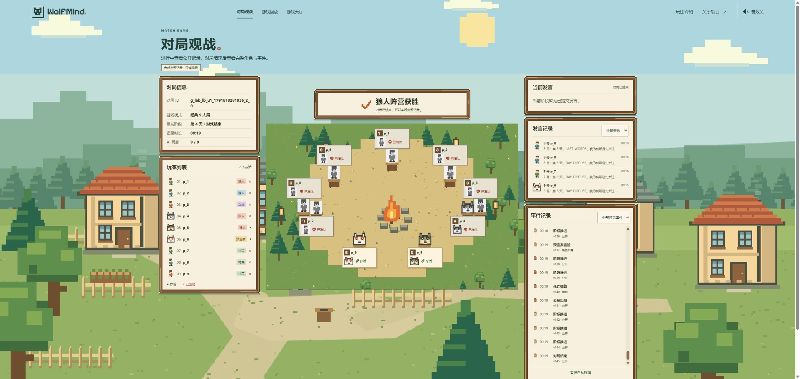
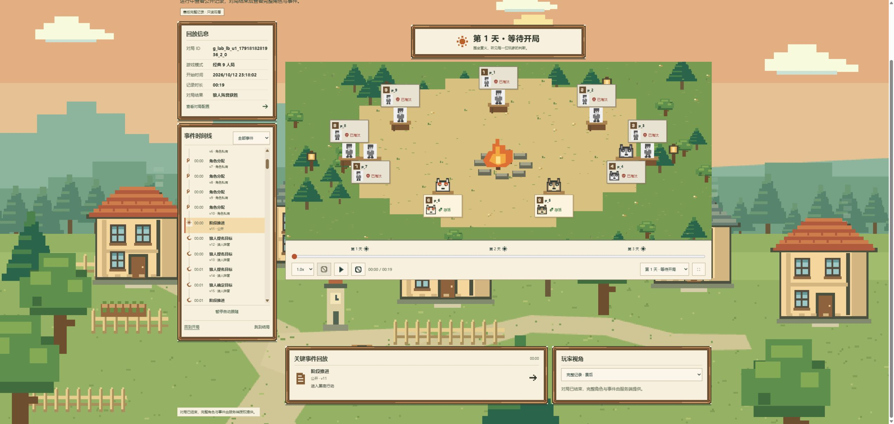

# WolfMind 实际体验与测试报告

测试日期：2026-10-12（Asia/Shanghai）。

结论：核心对局可以自动跑完，页面的像素村庄风格统一，注册、建房、AI 补位与终局同步可用。不过，回放的历史棋盘、实验室重新加载、真实对局入口与配置反馈存在可复现问题，应先修复这些问题再做上线验收。

## 环境与范围

- 使用 computer use 的浏览器控制，在 Chrome 操作真实页面；另用独立的 Codex 内置浏览器检查匿名赛后观战。
- 前端：`http://127.0.0.1:5173`，`VITE_USE_REAL_API=true`，同源代理到后端 `18080`。
- 后端：本次从当前源码构建的 Spring Boot JAR；Redis 数据库 14；独立 SQLite 文件 `backend/data/computer-use-qa.db`。未删除已有项目数据。
- 未找到当前环境的模型配置，后端显式启用 `wolfmind.agent.force-rule=true`。本次是规则机器人对局，未调用付费模型，不能据此评价 LLM 发言、推理、流式输出或模型成本。
- 使用独立本地测试账号。实验室首次创建配置被页面阻塞后，通过已存在的 REST 接口预置一份测试配置，再从页面创建批次；这一步是测试准备，不算页面首次创建配置通过。
- 体验覆盖：首页、玩法弹窗及 Escape、注册、登录回跳、大厅空状态与错误输入、创建房间、等待页、准备与 AI 补位、混合对局超时推进、九机器人自主对局、观战、回放、AI 分析、实验室、390×844 手机视口。
- 本次未修改业务源码、规则或公共契约，只增加报告、截图、运行日志与测试数据。
- 结束后已停止本次启动的前后端测试进程；Redis/SQLite 测试数据与证据文件保留，未删除原有数据。

## 对局结果

| 对局 | 结果 | 证据 |
| --- | --- | --- |
| `g_r_mv5e88wk_3`：1 真人 + 8 AI | 第 4 轮正常终局，狼人获胜，2 人存活 | 浏览器对局页显示终局及完整角色；真人行动窗口未及时操作，实际覆盖了超时跳过路径 |
| `g_lab_lb_u1_1791818281936_2_0`：9 AI | 19 秒，4 轮，狼人获胜，145 个事件，2 人存活 | 页面创建批次；服务端返回 FINISHED；浏览器显示 `AI 玩家 9 / 9` 与终局 |
| `g_lab_lb_u1_1791818731465_3_0`：9 AI | 15 秒，2 轮，狼人获胜，104 个事件，4 人存活 | 页面创建第二批次；独立匿名浏览器显示赛后完整记录，包含猎人开枪事件 |

两局九机器人都正常结束。这两局不是统计样本，不能据此判断阵营平衡。第二局进入匿名观战时已经结束，因此本次浏览器体验没有验证进行中的匿名秘密信息隔离；自动化测试结果另列。

## 优先修复的问题

### P1：回放回到开局后仍显示终局淘汰状态

复现：打开第一局回放，点击“回到开局”。时间轴为 `00:00 / 00:19`，标题为“第 1 天 · 等待开局”，但 1、2、3、4、7、8、9 号仍显示已淘汰，只剩 5、6 号存活。分析页早期时间点也有相同棋盘问题。

期望：棋盘、阶段、存活状态与选定的历史版本一致。服务端 `GET /games/{id}/replay?atVersion=11&from=1&to=11` 实测返回 `snapshot.version=11`、`phase=NIGHT_WOLF`、9 人存活，证明服务端历史快照可用。

原因定位：`frontend/src/features/observation/realObservationAdapter.ts:119` 把当前视图的存活状态作为初始玩家状态；`frontend/src/features/observation/projection.ts:4` 从这份终局状态开始投影，后续只能把玩家改为死亡，无法回退到历史存活状态。

建议：将真实回放的棋盘接到服务端 `atVersion` 快照；拖动时间轴时合并请求并丢弃迟到响应。加入“终局→开局→死亡前后→终局”的浏览器断言，核对人数与阶段。

### P1：实验室重新进入后显示 NaN 与 undefined

复现：运行一局实验批次，离开实验室再进入，或刷新页面。出现 `NaN%`、`当前批次 · 已结束 undefined 局`、`undefined / 1 局`，主进度又写着 `0 / 1`；比较表则正确显示已完成 1 局。

原因定位：`LabQueryService.java:51` 的配置目录直接返回 `LabBatch` 对象，其 JSON 不包含普通方法 `completed()`；进度接口则包含 `completed=1`。`realLabAdapter.ts:189` 将目录里的批次直接按完整进度响应传给 `toBatch`，`stores/lab.ts:25` 用缺失字段计算百分比。

建议：目录加载获得 `latestBatchId` 后再查询批次详情，或协调统一两个接口的批次 DTO。加真实响应形状校验，避免把缺失字段变成用户可见的 NaN。验收要包含整页刷新与新标签页恢复。

### P1：自定义提示词显示保存成功，但正文丢失且不会影响运行

复现：选“自定义指令”，输入“QA验证：发言前核对当前轮次，避免重复其他玩家原句。”，点击保存。页面提示已保存。刷新后仍选中自定义指令，但文本恢复为默认提示词。

原因定位：`realLabAdapter.ts` 的保存请求不发送 `prompt`，读取配置时固定使用 `defaultPrompt`。契约 `api-spec.md §8.1` 明确规定 `promptTemplateId` 当前只作为比对维度，不改变提示词装配；页面 `LabPage.vue:93` 却提供可编辑文本并宣称配置字段有运行时消费点。

建议：按现有批准契约隐藏或禁用真实模式的正文编辑，并明确模板标识的用途。若要支持自定义提示词，需要另行批准输入约束、持久化与装配契约，不能只让页面显示保存成功。

### P1：真实模式导航仍跳转 demo，无法找到刚跑完的对局

复现：实验室点击“AI 对局”进入 `/watch/demo`，显示“暂时无法查看对局”“对局状态为 不存在，不接受行动”。“AI 分析”及报告中的回放/分析链接也固定指向 demo。游戏终局页没有直接进入本局回放、分析的按钮。大厅正常路径也缺少实验室入口。

原因定位：`LabPage.vue:75` 等仍使用固定 demo 地址。

建议：批次结果逐局展示真实 gameId、状态、胜负，以及观战/回放/分析入口；在终局页和大厅补齐导航。没有选定对局时显示对局列表或明确空状态。增加真实模式全部导航不得引用 demo 的检查。

### P2：回放阶段下拉框出现 undefined，第四天无法按天选择

复现：第一局回放“跳转阶段”中多处显示“第 N 天 · undefined”，多个不同夜间阶段均叫“黑夜行动”。实际有第 4 轮，但播放控件与分析筛选只列第 1～3 天。

定位：`realObservationAdapter.ts` 的 `phaseOf` 没覆盖 `DAY_ANNOUNCE`、`VOTE_SETTLE` 等阶段；`AnalysisPage.vue:109` 将轮次写死为 3。

建议：使用完整阶段文案映射与明确的未知状态占位，从真实对局轮次生成选项；用四轮以上真实事件检查每个阶段和轮次均可选。

### P2：无模型、无配置时实验室无法从页面起步

复现：新账号进入实验室，提示“点击新建开始”，但“＋ 新建”禁用；配置库的“新建配置”点击后回到原页面，没有配置草稿。

定位：`LabPage.vue:85` 根据 `models.length` 禁用新建；`stores/lab.ts:58` 没有配置且没有模型时不创建草稿。后端未配置模型仍能正常跑规则基线，界面却没有相应入口。

建议：提供清楚的“规则机器人”基线选项，或明确提示管理员配置模型及其步骤。空状态的主要按钮必须可完成它宣称的动作。

## 体验与文案建议

- 实验室同一页面同时写“服务端实验室”“手动刷新推进预置样例”；报告写“本地实验报告”“全部结果为手工样例”，模型比较也标“示例”。真实接口已有结果，应统一标注真实来源，并保留无数据指标的解释。
- 分析页有 50 条预言家轨迹，早期查看查验事件时“最终选择”仍显示“无动作 · 未记录”，判断更新写“0 号”。服务端确有 FINISHED / SEER_INSPECT / submitted=true。当前页面按时间选单条 CONTEXT 等轨迹，无法完整解释一次决策，建议按回合关联上下文、候选、工具与最终动作；没有目标时省略座位号。
- “威胁等级”根据角色显示“受到公开质疑 · 示例判断”，不能作为真实分析结论。应接明确数据口径或隐藏该项。
- 狼人夜间目标列表观察到同阵营的 5、6 号也可选择。未赶上窗口提交，不能断言服务器接受非法目标。建议由服务端权限返回可选目标，页面清楚禁用队友。
- 等待页未找到房主起身转观战的入口，想直接跑九 AI 必须另走实验室。建议提供“九 AI 快速观战”入口，并清楚标明是否使用模型或规则基线。
- 游戏页把多个夜间技能阶段都叫“夜间行动”，自己的行动结束后只写没有可提交动作。建议显示“正在等待预言家/女巫”等不泄露隐藏结果的阶段说明。
- 分析页 390×844 宽度能正常重排，未观察到横向溢出；但卡牌纵向很长，建议手机默认折叠非当前 Agent 信息，优先展示发言和决策详情。
- 首页视觉与弹窗焦点反馈一致，空房间号和不存在的房间号也给出清晰错误。这些交互可以作为其他页面空状态与错误反馈的参考。
- 后端 README 仍写认证、WebSocket、AI 未实现；前端 README 仍写分析和实验室没接真实接口。应按当前实现更新启动说明与验收边界，并增加根 README。

## 本次实际执行的自动化检查

| 检查 | 结果 | 日志 |
| --- | --- | --- |
| `mvn -o -pl server -am test package` | engine 105 通过；server 570 项中 569 通过、1 跳过；0 失败；构建成功 | `backend/computer-use-backend-check.log` |
| `npm test` | 29 文件、325 项通过 | `frontend/computer-use-unit-check.log` |
| `npm run build` | 类型检查、Vite 构建通过 | `frontend/computer-use-build-check.log` |
| `npm run e2e:adapters` | 5 文件、15 项通过 | `frontend/computer-use-adapters-check.log` |
| `npm run e2e:pages` | 21 项通过、1 项失败 | `frontend/computer-use-pages-check.log` |
| 发言/投票失败用例单独复跑 | 1 项通过、9 项未选择；原失败发生于等待“发言”按钮可用 | `frontend/computer-use-pages-rerun.log` |
| `npm run e2e:ws` | 4 项通过 | `frontend/computer-use-ws-check.log` |
| `/api/v1/health` | UP，Redis 与 SQLite 必需依赖均 UP；LLM 明确标未配置、规则兜底 | 本次接口读取 |

页面套件曾失败而单独复跑通过，应保留为不稳定用例调查，不能把完整套件报告成全部通过。需要排查 Redis 环境、阶段计时和等待条件，当前证据不足以给出确定根因。

JSON 下载测试等待浏览器下载事件时工具超时，之后通过新标签页恢复；未验证下载文件内容，不判定导出功能通过或失败。临时手机视口已恢复。

## 后续验收边界

这次覆盖主要产品页面与实际规则机器人链路，不是全面上线验收。尚需真实 LLM 整局、进行中匿名浏览器隔离、多人多账号整局、人工断网重连、Firefox/WebKit、完整键盘/屏幕阅读器、Redis/后端故障恢复、部署重现与并发压力测试。

修复顺序建议：先修历史棋盘、批次恢复与误导性配置保存，再补真实对局导航和阶段映射，最后整理文案、手机信息密度与启动说明。先补真实接口响应及整页刷新用例，再做视觉优化。

## 修复状态（2026-10-12，由开发会话补充）

本报告的四个 P1 与两个 P2 已全部修复，逐条对照与复现命令见根目录 `TASKS.md` 的"QA 缺陷修复"一节。
修复后本轮实跑：后端 engine 105 + server 570 通过（1 跳过）、前端 358 通过、`e2e:adapters` 17 通过
（含两条新增的真实后端验收：回放开局棋盘、实验室重载进度）、`e2e:pages` 22/22、`e2e:ws` 4/4、冒烟 44/44。

本报告"后续验收边界"里的项目仍然成立，不在本次修复范围内：真实 LLM 整局、进行中匿名浏览器隔离、
多人多账号整局、人工断网重连、Firefox / WebKit、完整键盘与屏幕阅读器、Redis / 后端故障恢复、
部署重现与并发压力测试。体验与文案建议中未处理的部分同样记在 `TASKS.md` 的"未修"一行。
